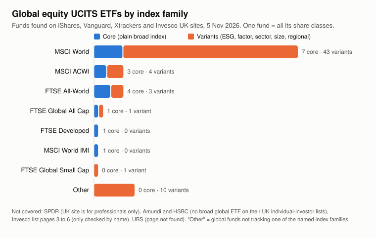

# Global Equity ETFs: Fees, Tracking and Product Gaps

Work in progress. Started October 2026. Phase 1 (choosing the funds) is done and the documents are being collected and read. Nothing has been concluded yet.

## The question

Among UCITS ETFs that track a global equity index, which ones give investors good value, and is there a gap in what's on offer?

## What I'm doing

1. Work out which global indices have enough UCITS ETFs to compare, then pick 12 to 15 funds from issuers' public websites. I check each site's terms before using anything.
2. Pull fees, index, fund size and replication method out of those documents using an AI tool, then check 10 funds by hand to see how often it gets things right.
3. Compare the factsheet figures with the key document figures and list every mismatch.
4. Analyse fees against fund size, and tracking difference, in Excel and SQL.
5. Build a simple break-even model for a possible new product, with three scenarios and the assumptions labelled.
6. Write a two-page brief and a short deck.

The phases are laid out in [PHASES.md](PHASES.md). The exact extraction prompt is in [method/extraction_prompt.md](method/extraction_prompt.md). Current status is in [PROGRESS.md](PROGRESS.md), my choices are in [DECISIONS.md](DECISIONS.md) and my errors are in [MISTAKES.md](MISTAKES.md).

## Ground rules

- Every number comes from the documents or from my own calculations. No estimates.
- Public data only, collected from issuer websites after reading each source's terms.
- Where I make an assumption, it's labelled as one.
